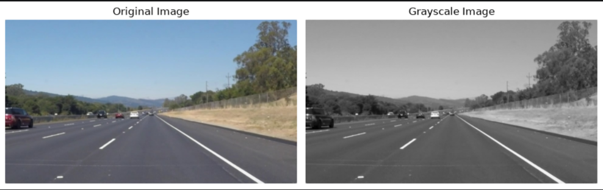
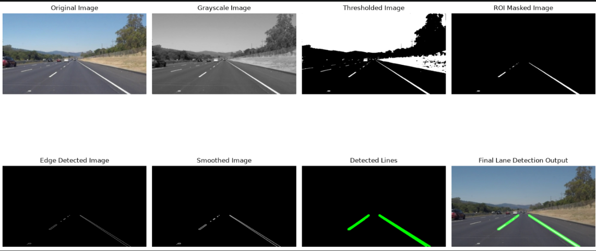

# DIGITAL_IMAGE_PROCESSING_TECFHNIQUES_EX7
# Road Lane Detection Using Python and OpenCV

## Project Overview
This project detects road lane lines from an input road image using Python and OpenCV. It applies image processing techniques to identify lane markings and highlight them on the original road image.

The main goal is to detect road lanes using image processing methods such as grayscale conversion, thresholding, ROI masking, edge detection and Hough Line Transform.

## Author

**Karnam Pareesh Naidu**  
Department of Artificial Intelligence and Data Science

## Technologies Used
- Python
- OpenCV
- NumPy
- Matplotlib

## Image Processing Techniques

1. **Image Loading:** Reads the road image using OpenCV.
2. **Grayscale Conversion:** Converts the original color image into a grayscale image.
3. **Thresholding:** Separates important road markings from the background using binary thresholding.
4. **ROI Masking:** Focuses only on the required road region and ignores unwanted areas.
5. **Edge Detection:** Uses the Canny Edge Detection method to identify road lane edges.
6. **Gaussian Blur:** Removes noise and smooths the image.
7. **Hough Line Transform:** Detects straight lane lines from the processed image.
8. **Lane Visualization:** Draws detected lines in green and combines them with the original image.

## Project Workflow

```text
Input Road Image
       |
Grayscale Conversion
       |
Thresholding
       |
ROI Masking
       |
Canny Edge Detection
       |
Gaussian Blur
       |
Hough Line Transform
       |
Draw Detected Lines
       |
Final Lane Detection Output
```

## Installation

Install the required Python libraries:

```bash
pip install opencv-python numpy matplotlib
```

## How to Run

1. Clone this repository:

```bash
git clone YOUR_REPOSITORY_URL
```

2. Open the project in VS Code or Jupyter Notebook.
3. Install the required libraries.
4. Place your road image in the project folder.
5. Update the image path in the code.
6. Run all notebook cells.
# PROGRAM(PYTHON):
## CODE:
~~~
import cv2
import numpy as np
import matplotlib.pyplot as plt
~~~
## CODE:
~~~
# Read the image using OpenCV

###
# Your Code Here
image = cv2.imread(r"C:\Users\acer\Downloads\images1.jpeg")
if image is None:
    raise FileNotFoundError("road.jpg was not found. Place road.jpg in the same folder as this notebook.")
###

~~~
## CODE:
~~~
from matplotlib.cm import gray


plt.figure(figsize=(10,5))

###
# Your Code Here
plt.subplot(1,2,1)
plt.imshow(cv2.cvtColor(image, cv2.COLOR_BGR2RGB))
plt.title("Original Image")
plt.axis("off")

plt.subplot(1,2,2)
gray = cv2.cvtColor(image, cv2.COLOR_BGR2GRAY)
plt.imshow(gray, cmap='gray')
plt.title("Grayscale Image")
plt.axis("off")

plt.tight_layout()
plt.show()
###

~~~
## OUTPUT:

## CODE:
~~~
# Apply thresholding

threshold = cv2.threshold(gray, 150, 255, cv2.THRESH_BINARY)
###

~~~
## CODE:
~~~
# ROI masking already provided
# (Do not modify)

height, width = threshold[1].shape

mask = np.zeros_like(threshold[1])

polygon = np.array([[
    (0, height),
    (width // 2 - 60, height // 2 + 60),
    (width // 2 + 60, height // 2 + 60),
    (width, height)
]], np.int32)

cv2.fillPoly(mask, polygon, 255)

roi = cv2.bitwise_and(threshold[1], mask)
~~~
## CODE:
~~~
# Perform Edge Detection

###
# Your Code Here
edges = cv2.Canny(roi, 50, 150)
###

~~~
## CODE:
~~~
# Apply Gaussian Blur

###
# Your Code Here
blurred = cv2.GaussianBlur(edges, (5,5), 0)
###

~~~
## CODE:
~~~
# Detect lines using Hough Transform

###
# Your Code Here
lines = cv2.HoughLinesP(
    blurred,
    rho=1,
    theta=np.pi/180,
    threshold=50,
    minLineLength=50,
    maxLineGap=100
)
###

~~~
## CODE:
~~~
# Already implemented
# (Do not modify)

line_image = np.zeros_like(image)

if lines is not None:
    for line in lines:
        x1, y1, x2, y2 = line
        cv2.line(line_image, (x1, y1), (x2, y2), (0, 255, 0), 5)

final_output = cv2.addWeighted(image, 0.8, line_image, 1.0, 0)

plt.figure(figsize=(16,10))

plt.subplot(2,4,1)
plt.imshow(cv2.cvtColor(image, cv2.COLOR_BGR2RGB))
plt.title("Original Image")
plt.axis("off")

plt.subplot(2,4,2)
plt.imshow(gray, cmap='gray')
plt.title("Grayscale Image")
plt.axis("off")

plt.subplot(2,4,3)
plt.imshow(threshold[1], cmap='gray')
plt.title("Thresholded Image")
plt.axis("off")

plt.subplot(2,4,4)
plt.imshow(roi, cmap='gray')
plt.title("ROI Masked Image")
plt.axis("off")

plt.subplot(2,4,5)
plt.imshow(edges, cmap='gray')
plt.title("Edge Detected Image")
plt.axis("off")

plt.subplot(2,4,6)
plt.imshow(blurred, cmap='gray')
plt.title("Smoothed Image")
plt.axis("off")

plt.subplot(2,4,7)
plt.imshow(cv2.cvtColor(line_image, cv2.COLOR_BGR2RGB))
plt.title("Detected Lines")
plt.axis("off")

plt.subplot(2,4,8)
plt.imshow(cv2.cvtColor(final_output, cv2.COLOR_BGR2RGB))
plt.title("Final Lane Detection Output")
plt.axis("off")

plt.tight_layout()
plt.show()
~~~
## OUTPUT:

# OUTPUT:

The project displays the following results:

- Original Image
- Grayscale Image
- Thresholded Image
- ROI Masked Image
- Edge Detected Image
- Smoothed Image
- Detected Lane Lines
- Final Lane Detection Output

## Applications
- Road lane detection
- Driver assistance systems
- Autonomous vehicle technology
- Road monitoring systems
- Intelligent transportation systems


## Conclusion

This project demonstrates how basic image processing techniques can be used to detect road lane lines. By combining OpenCV methods, the system identifies lane markings and highlights them on the original road image.